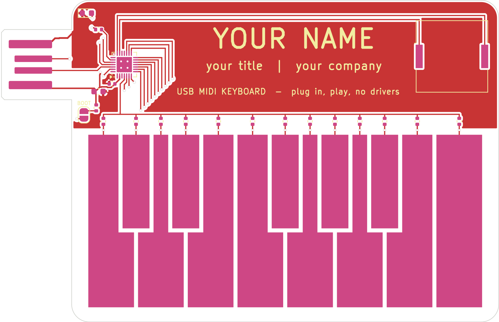
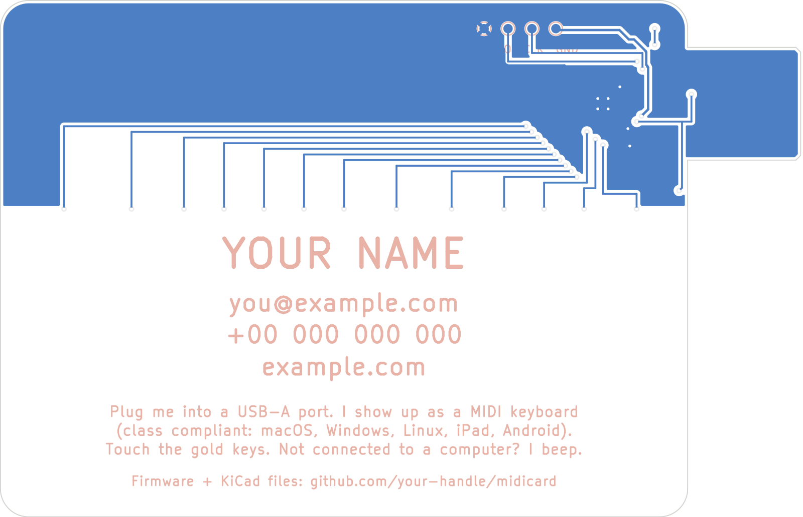

# MIDI Card

A PCB business card (85 x 55 mm, 0.8 mm FR4) that plugs straight into a USB-A port
and shows up as a class-compliant USB MIDI keyboard. No drivers on Windows, macOS,
Linux, iPad (with adapter) or Android.

- 13 capacitive touch keys in bare copper (C4 to C5), ENIG gold looks best
- CH32X035G8U6 RISC-V MCU with native USB, powered directly from USB 5 V (no regulator, no crystal)
- Piezo buzzer: plays notes the host sends, and plays the keys itself when only powered (phone charger / power bank)
- Status LED, BOOT solder jumper for the WCH USB bootloader, SWD test pads on the back
- Single-sided assembly, 8 BOM lines, all on LCSC/JLCPCB




## Repository layout

| Path | What |
|---|---|
| `hardware/` | KiCad 7 project (`midicard.kicad_sch`, `midicard.kicad_pcb`, local libs in `lib/`) |
| `hardware/production/` | JLCPCB gerber zip, BOM and CPL |
| `firmware/` | Firmware (C, [ch32fun](https://github.com/cnlohr/ch32fun) as a submodule) |
| `scripts/` | Generators: the schematic, board, routing and production files are all built from `scripts/design.py` |
| `docs/` | Renders, schematic PDF, DRC report |

## Ordering at JLCPCB

1. Upload `hardware/production/midicard-gerbers-jlcpcb.zip`.
2. Options: 2 layers, **thickness 0.8 mm**, surface finish **ENIG**, any mask colour (black or purple looks great with gold), "Remove order number": specify a location or pay to remove it, so it does not land on the front.
3. Enable **PCB Assembly**, top side only, then upload `midicard-bom-jlcpcb.csv` and `midicard-cpl-jlcpcb.csv`.
4. **Check the 3D/assembly preview**, mainly U1 pin 1, D1 polarity and BZ1 rotation. Rotate in the JLC tool if anything is off.
5. Extended parts: the MCU (C7437027) and the buzzer (C113159) each add a one-off fee of about $3 per order.

Rough cost (unverified, check the quote): about $3 to $5 per card at 20 to 50 pieces including ENIG,
assembly and parts (parts are about $1.10 per card). Skip the buzzer to save $0.66 per card and one extended-part fee.

### The USB plug needs a shim

A USB-A plug is about 2.0 to 2.2 mm thick; the card is 0.8 mm. Stick 1.2 to 1.4 mm of material
(two layers of thick double-sided tape, a piece of 1.2 mm plastic, or a cut-up loyalty card plus tape)
under the plug area on the **back**, so the gold contacts press against the port springs.
With contacts facing up and the tip pointing away from you, the pins read VBUS, D-, D+, GND left to right.

**First plug-in:** use a USB power meter or a hub you don't care about, and check that the board draws only a few mA.

## Firmware

```sh
git submodule update --init
cd firmware
make          # needs riscv64-unknown-elf-gcc (or riscv-none-elf-gcc) with newlib/picolibc
```

Flashing the first time, either:

- **USB bootloader:** bridge the BOOT jumper (JP1) with a blob of solder or tweezers, plug in,
  run `wchisp flash midicard.bin` ([wchisp](https://github.com/ch32-rs/wchisp)), then open the jumper again.
- **WCH-LinkE:** connect to the back pads VBUS/SWDIO/SWCLK/GND and run `make flash` (ch32fun's `minichlink`).

Behaviour:

- Calibrates touch baselines at power-up, so **keep fingers off the keys while plugging in**.
- Sends Note On/Off 60 to 72, velocity 100, on cable 0 / channel 1.
- Host Note On messages play on the buzzer.
- If no USB host enumerates it within 2 s (charger/power bank), the keys beep the notes themselves.
- LED: on when connected, flickers on notes, slow blink in standalone mode.

**USB IDs:** the firmware uses `1209:0001`, the pid.codes *test* ID. Request your own free PID at
[pid.codes](https://pid.codes) before handing cards out, and change it in `firmware/usb_config.h`.

Touch tuning is in `firmware/midicard.c` (`MAX_T`, the ON threshold `max(6, baseline/3)`).
Nothing here has been tested on real hardware yet; expect to tweak the thresholds.

## Regenerating the design

Everything is generated from `scripts/design.py` (pins, nets, parts) and `scripts/gen_pcb.py` (placement, outline, silkscreen).

```sh
scripts/build.sh   # schematic, placement, routing, pours, DRC, gerbers, BOM, CPL, checks
```

To change the name and contact text, edit the silkscreen strings in `scripts/gen_pcb.py`
(or just edit them in KiCad), and the USB strings in `firmware/usb_config.h`.

## Design notes

- **Why CH32X035 instead of CH32V203:** it runs from 5 V directly and its USB works from the internal oscillator, which drops the LDO and crystal. It costs $0.27.
- **Touch sensing:** RC timing. Each key has a 1 MΩ resistor to a shared SEND pin (PC3). SEND goes high and the firmware times all 13 pins in parallel. The chip's own touch ADC has only 12 usable channels for 13 keys.
- PB1 and PB5 are bonded together inside the QFN-28, so PB5 stays an input.
- PC17 (D+) high at reset enters the bootloader, so JP1 + R15 pull D+ to VBUS.
